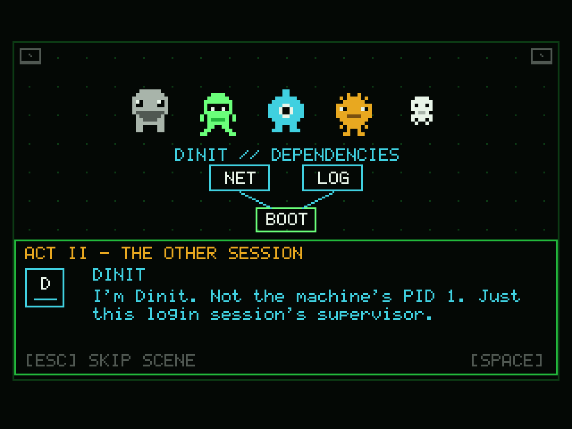
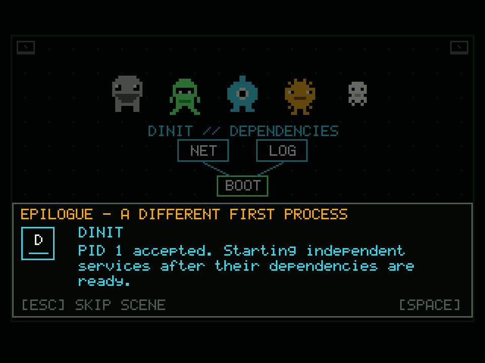
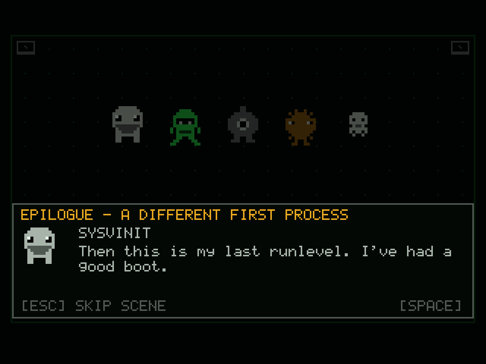
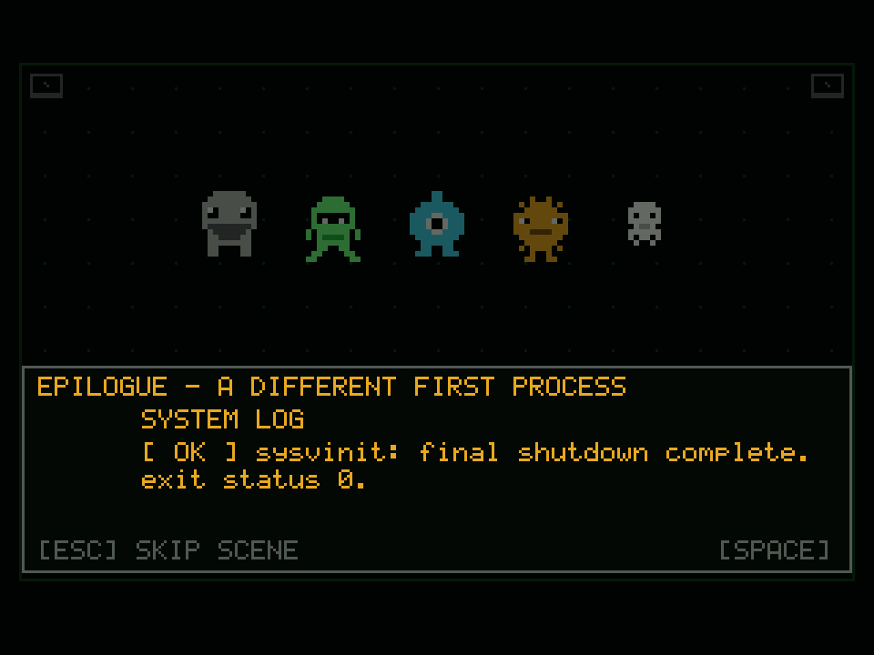

# INIT WARS: Campaign story expansion

This document describes the extended ten-wave Campaign. It is a fictional arcade
story inspired by real init and service-supervision ideas; it is not a claim about
what any distribution will adopt.

## The chapter flow (24 waves, 1.6.0)

| Point | Scene | What happens |
|---|---|---|
| Before 1 | The Old Machine | The five init systems meet systemd's "default" status. |
| Before 2 | The Boot Trace | A surviving service tree is found. |
| Before 3 | The Service Bridge | A device/network failure forces cooperation. |
| Before 4 | The Quiet Nodes | Fedora (2011) and Arch (2012) already moved; terminals go dark. |
| Before 5 | The Upstart | Ubuntu's Upstart (in use since 2006) appears, foreshadowing its move. |
| Before 6 | The Migration | 2014: Debian, Red Hat, SUSE and Ubuntu are all deciding. |
| Before 7 | The Vote | Debian's technical committee picks systemd as the next default; the vote was close. |
| During 9 | Legacy | Notices: RHEL 7 (June 2014), SLE 12 (Oct 2014), Ubuntu (Feb 2015). SysVinit is weakened but stays playable. |
| Before 10 | The Holdouts | Devuan forks Debian (2014); Void, Alpine and Gentoo never switched. |
| Before 11 | The Other Session | Dinit is found supervising a user session. |
| Before 13 | The Infinite Boot | systemd: everything is a unit. |
| Before 14 | Scope Creep | Logging, logins, networking and timers all wear one badge. |
| Before 16 | The Dependency Loop | A circular dependency crisis; repair only the affected branch. |
| Before 18 | The Plan | Roles are assigned for the assault on PID 1. |
| Before 19 | The Root Shell | Descent toward the kernel boundary. |
| Before 21 | The Last Runlevel | SysVinit holds the old route open. |
| Before 23 | Before PID 1 | A quiet moment before the final arena. |
| Before 24 | PID 1 | The final fight. |
| After 24 | A Different First Process | Dinit accepts PID 1; SysVinit exits cleanly. |

Dates are the real release or announcement dates as best recalled; verify before quoting them elsewhere.

All campaign scenes can be skipped with Esc. The in-fight Red Hat scene keeps
its short anti-accidental-skip guard because it interrupts active play.

## Why Dinit behaves this way

Dinit is a real service supervisor with dependency support that can also run as
the Linux system init. Its upstream documentation describes parallel service
startup where dependencies allow it, monitoring supervised processes, automatic
rate-limited restarts, and rolling back dependent services when a dependency
fails so they can be restarted after the dependency is restored. It can also run
as a user process/service manager. Those real capabilities inspired its role as
the quiet supervisor found in a user session before it offers to become PID 1.

Dinit's design is intentionally scoped: it is meant to coordinate services and
integrate with other system software, not absorb logging, device management,
network management, and every other subsystem into one monolith. The story
therefore makes Dinit's promise **supervision, not ownership**. The other
characters keep their specialisms after the handoff.

The handoff is fictional. Dinit can act as Linux PID 1 according to its own
documentation, but this story does not claim that a real distribution is
planning to replace systemd with it. See:

- [Dinit upstream README](https://github.com/davmac314/dinit#readme)
- [Dinit manual page](https://davmac.org/projects/dinit/man-pages-html/dinit.8.html)
- [Dinit design comparison](https://github.com/davmac314/dinit/blob/master/doc/COMPARISON)
- [Chimera Linux service management](https://chimera-linux.org/docs/configuration/services)

## SysVinit's ending

SysVinit's arc is about being useful even after the world moves on. The Red Hat
notice hurts because it makes the change personal; the later chapters let him
choose how to use the experience he still has. He holds open the legacy route,
helps the others reach the final arena, and then exits cleanly after Dinit takes
over. The ending is deliberately quiet: no graphic destruction, no claim that
SysVinit has vanished from real Linux, and no erasure of the work he represents.
The archived runlevel notes make his legacy part of the new system.

## Implementation notes

- Campaign is 24 waves; see balance.c for the authored tables.
- Endless and Boss Rush still skip all Campaign scenes.
- The Red Hat interruption remains the only in-fight story scene.
- A Campaign victory is not saved until the player completes or skips the
  epilogue, so the final story is part of the result flow rather than a detached
  extra screen.
- The Dinit mark is drawn using the game's existing pixel font and renderer;
  no external art or runtime dependencies were added.

## Renderer previews

These 3x nearest-neighbour images are captured by the headless regression test
from the game's real `view_draw` software renderer. They let reviewers inspect
the new composition without pretending that SDL2/Window Maker desktop testing
has happened. The official README screenshot gallery remains pending until the
real SDL2 app is captured and reviewed on desktop.

